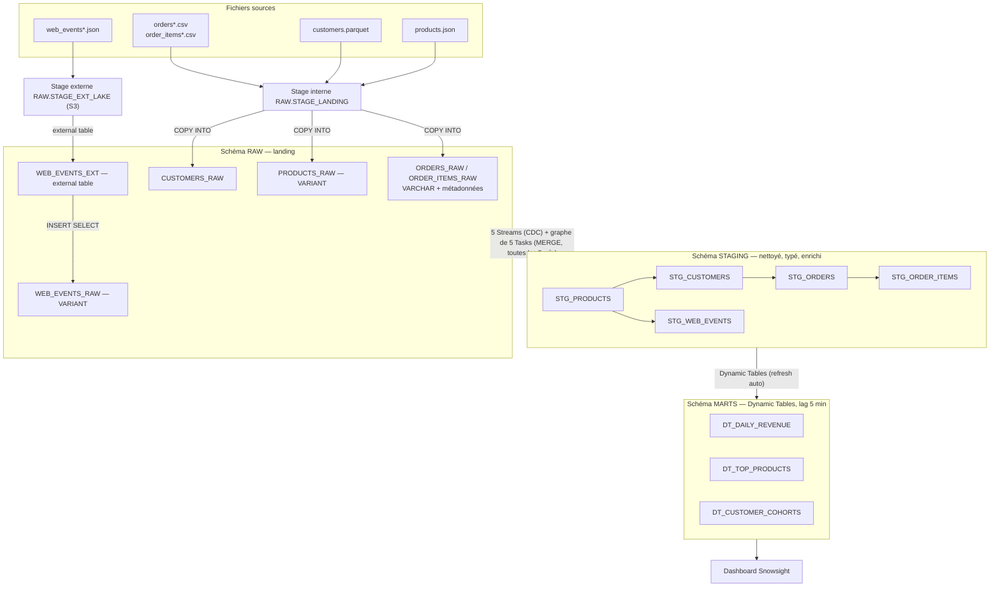

# ShopFlow — Pipeline analytique e-commerce sur Snowflake

Projet fil rouge Snowflake (5 jours) : ingestion de fichiers bruts (CSV, Parquet, JSON) vers une architecture **RAW → STAGING → MARTS**. Le pipeline est automatisé par **Streams + Tasks** et les marts sont des **Dynamic Tables**. Le résultat est restitué dans un **dashboard Snowsight**.

---

## 1. Contexte

ShopFlow est une boutique e-commerce française de produits high-tech. Chaque jour, quatre sources arrivent dans un bucket :

| Source | Format | Origine | Lot J1 | Lot J2 |
|---|---|---|---|---|
| Commandes | CSV | Back-office | 50 000 | 5 000 |
| Lignes de commande | CSV | Back-office | 127 827 | 12 933 |
| Clients | Parquet (snappy) | CRM | 10 000 | — |
| Produits | JSON (array, imbriqué) | PIM | 500 | — |
| Événements web | JSON line-delimited | Tracking | 200 000 | 20 000 |

L'objectif est de construire une plateforme data qui transforme ces fichiers en indicateurs de pilotage (CA quotidien, top produits, rétention) mis à jour automatiquement.

## 2. Architecture



### Objets Snowflake

| Couche | Objets |
|---|---|
| Compte | Rôles `SHOPFLOW_ENGINEER`, `SHOPFLOW_ANALYST` · warehouses `WH_INGEST` (XS), `WH_TRANSFORM` (S), `WH_BI` (XS), tous avec `AUTO_SUSPEND = 60` · storage integration `SI_SHOPFLOW_S3` |
| RAW | `STAGE_LANDING`, `STAGE_EXT_LAKE`, `FF_CSV_ORDERS`, `FF_PARQUET`, `FF_JSON`, `ORDERS_RAW`, `ORDER_ITEMS_RAW`, `CUSTOMERS_RAW`, `PRODUCTS_RAW`, `WEB_EVENTS_EXT`, `WEB_EVENTS_RAW`, `V_WEB_EVENTS_SRC`, streams `STR_*` |
| STAGING | `STG_PRODUCTS`, `STG_CUSTOMERS`, `STG_ORDERS`, `STG_ORDER_ITEMS`, `STG_WEB_EVENTS`, `FN_LOAD_BATCH`, tasks `TSK_*` |
| MARTS | `DT_DAILY_REVENUE`, `DT_TOP_PRODUCTS`, `DT_CUSTOMER_COHORTS` |

### Graphe de tasks

```
TSK_LOAD_STG_PRODUCTS            root · SCHEDULE 5 MINUTE · WHEN l'un des 5 streams a des données
 ├── TSK_LOAD_STG_WEB_EVENTS
 └── TSK_LOAD_STG_CUSTOMERS
      └── TSK_LOAD_STG_ORDERS
           └── TSK_LOAD_STG_ORDER_ITEMS
                └── (bonus) TSK_DQ_CHECKS   ← aussi AFTER TSK_LOAD_STG_WEB_EVENTS
```

Les référentiels (produits, clients) sont chargés en premier, parce que les faits (commandes, lignes, événements) s'y joignent pour l'enrichissement. La clause `WHEN SYSTEM$STREAM_HAS_DATA(...)` évite de démarrer le warehouse quand rien n'a changé.

## 3. Choix de conception

1. **RAW en VARCHAR/VARIANT et métadonnées de chargement.** La landing n'échoue jamais sur un typage. Chaque ligne garde `SOURCE_FILE` (`METADATA$FILENAME`), `FILE_ROW_NUMBER` et `LOADED_AT`.
2. **Clé technique par lot.** Le lot J2 **réutilise les identifiants de J1** (`O0000001`, `E000000001`…) avec des contenus différents. Les clés STAGING sont donc composites : `ORDER_KEY = <lot>-<order_id>` (ex. `J2-O0000001`). Le lot est déduit du nom de fichier par `STAGING.FN_LOAD_BATCH`.
3. **Ligne de commande = ligne de fichier.** Un même produit apparaît parfois sur plusieurs lignes d'une commande (266 cas). Ces lignes sont légitimes, car `total_amount` n'est égal à la somme des lignes que si on les garde toutes. La clé est `<lot>-<order_id>-<n° de ligne>` et on ne fait pas de `DISTINCT`.
4. **Streams `SHOW_INITIAL_ROWS = TRUE`.** Les streams sont créés au Jour 3, après le chargement de J1. Sans cette option, l'historique J1 n'atteindrait jamais STAGING.
5. **Streams standard et MERGE complet.** Les DELETE et UPDATE de RAW se propagent jusqu'aux marts : c'est ce qui rend l'exercice Time Travel visible sur le dashboard. Dans le flux, chaque clé est dédoublonnée en privilégiant l'`INSERT`.
6. **COPY idempotent.** Le même `COPY INTO` sert pour J1 et J2. Les métadonnées de chargement (64 jours) sautent les fichiers déjà chargés, donc **jamais de `FORCE = TRUE`**.
7. **Règles métier des marts.** Le CA ne compte que les commandes `completed`. Les commandes datées dans le futur sont exclues. Les fenêtres « 14/30 derniers jours » sont ancrées sur la **dernière date de commande disponible**, car J1 s'arrête au 30/06/2026 et `CURRENT_DATE - 30` donnerait un mart vide. En production, on reviendrait à `CURRENT_DATE()`.
8. **Un warehouse par workload.** Ingestion, transformation et BI sont séparées, sans contention, et la consommation est lisible par usage.

## 4. Prérequis

- Un compte Snowflake, l'essai gratuit suffit. Il est en édition **Enterprise**, ce qui est nécessaire pour les bonus masking et row access policies.
- Un utilisateur disposant de `ACCOUNTADMIN` pour la mise en place : rôles, `EXECUTE TASK` et storage integration.
- [SnowSQL](https://docs.snowflake.com/en/user-guide/snowsql) pour les `PUT`, ou l'upload de fichiers de Snowsight.
- **Option A (recommandée) pour l'external table** : un bucket S3 et une IAM role en lecture (voir §6, point 1).
- Aucun mot de passe ni aucune clé dans les scripts. La connexion SnowSQL se configure dans `~/.snowsql/config`, hors dépôt.

## 5. Structure du dépôt

```
shopflow/
├── README.md
├── data/
│   ├── j1/  customers.parquet, products.json, orders.csv, order_items.csv, web_events.json
│   └── j2/  orders_j2.csv, order_items_j2.csv, web_events_j2.json
├── sql/
│   ├── 01_setup_and_ingest.sql        J1 – rôles, warehouses, base, stage, file formats, COPY
│   ├── 02_semi_structured.sql         J2 – JSON, FLATTEN, external table, perfs
│   ├── 03_streams_tasks.sql           J3 – streams, STAGING, tasks, test lot J2
│   ├── 04_marts_and_timetravel.sql    J4 – dynamic tables, Time Travel, UNDROP
│   ├── 05_dashboard.sql               J5 – une requête par tuile
│   ├── 06_bonus_governance_quality.sql bonus – masking, row access, contrôles DQ
│   └── 99_pause_and_cleanup.sql       pause du soir / remise à zéro
├── screenshots/                       captures du dashboard et du task graph
└── slides/                            support de soutenance
```

> `web_events.json` pèse 76 Mo. GitHub refuse les fichiers de plus de 100 Mo et avertit au-delà de 50 Mo. Gardez-le tel quel ou compressez-le (`gzip`, Snowflake lit le `.gz` nativement).

## 6. Reproduction pas à pas

Exécuter les scripts **dans l'ordre**, section par section, dans une worksheet Snowsight.

| # | Script | Avant d'exécuter | Contrôle de fin |
|---|---|---|---|
| 1 | `01_setup_and_ingest.sql` §0–5 | — | `SHOW WAREHOUSES` : 3 warehouses suspendus |
| 2 | Upload J1 (CSV, Parquet) | voir commandes ci-dessous | `LIST @RAW.STAGE_LANDING` |
| 3 | `01_setup_and_ingest.sql` §6–7 | — | 50 000 / 127 827 / 10 000 lignes |
| 4 | Upload `products.json`, `web_events.json` | et `web_events.json` dans S3 (option A) | — |
| 5 | `02_semi_structured.sql` | remplacer `<ARN_DE_VOTRE_ROLE_IAM>` et `<VOTRE_BUCKET>`, **ou** basculer sur l'option B | 500 produits, 200 000 événements |
| 6 | `03_streams_tasks.sql` §1–5 | — | 5 tasks `started`, STAGING peuplé |
| 7 | Upload lot J2, puis `03_streams_tasks.sql` §6 | — | 55 000 commandes en STAGING |
| 8 | `04_marts_and_timetravel.sql` | — | 3 DT, restauration à 55 000 lignes |
| 9 | `05_dashboard.sql` → tuiles Snowsight | — | dashboard |
| 10 | *(bonus)* `06_bonus_governance_quality.sql` | — | `DQ OK` |
| ☾ | `99_pause_and_cleanup.sql` §1 | **chaque soir** | warehouses `SUSPENDED` |

Uploads avec SnowSQL, depuis la racine du dépôt :

```sql
-- Lot J1
PUT file://data/j1/orders.csv        @SHOPFLOW_DB.RAW.STAGE_LANDING/orders/      AUTO_COMPRESS=TRUE;
PUT file://data/j1/order_items.csv   @SHOPFLOW_DB.RAW.STAGE_LANDING/order_items/ AUTO_COMPRESS=TRUE;
PUT file://data/j1/customers.parquet @SHOPFLOW_DB.RAW.STAGE_LANDING/customers/   AUTO_COMPRESS=FALSE;
PUT file://data/j1/products.json     @SHOPFLOW_DB.RAW.STAGE_LANDING/products/    AUTO_COMPRESS=TRUE;
PUT file://data/j1/web_events.json   @SHOPFLOW_DB.RAW.STAGE_LANDING/web_events/  AUTO_COMPRESS=TRUE;
-- Lot J2 (Jour 3 seulement)
PUT file://data/j2/orders_j2.csv      @SHOPFLOW_DB.RAW.STAGE_LANDING/orders/      AUTO_COMPRESS=TRUE;
PUT file://data/j2/order_items_j2.csv @SHOPFLOW_DB.RAW.STAGE_LANDING/order_items/ AUTO_COMPRESS=TRUE;
PUT file://data/j2/web_events_j2.json @SHOPFLOW_DB.RAW.STAGE_LANDING/web_events/  AUTO_COMPRESS=TRUE;  -- option B
```

## 7. Résultats attendus (pour valider votre exécution)

Ces valeurs ont été calculées hors Snowflake, avec la même logique, sur les fichiers fournis. Les valeurs qui dépendent de la date d'exécution sont données **au 02/11/2026** (filtre « pas de commande future »).

| Contrôle | Après J1 | Après J2 |
|---|---|---|
| `RAW.ORDERS_RAW` | 50 000 | 55 000 |
| `RAW.ORDER_ITEMS_RAW` | 127 827 | 140 760 |
| `RAW.WEB_EVENTS_RAW` | 200 000 | 220 000 |
| `STG_ORDERS` (lots J1 / J2) | 50 000 / — | 50 000 / 5 000 |
| Commandes dont total ≠ somme des lignes | 0 | 0 |
| Lignes de commande orphelines | 0 | 0 |
| CA total (`completed`) | **309 130 635,97 €** | 330 988 862,72 € *(au 02/11)* |
| Panier moyen global | 8 250,96 € | 8 268,11 € |
| Jours dans `DT_DAILY_REVENUE` | 181 (01/01 → 30/06) | 306 (→ 02/11) |
| Top 1 produit 30 j | P00386 · 299 335,19 € | P00209 · 51 155,68 € |
| Cohorte 2026-01 : taille / rétention M+2 | 283 / 53,36 % | idem |
| Commandes antérieures à l'inscription | 4 909 | 4 909 (aucune en J2) |
| Commandes J2 datées après le 02/11/2026 | — | 1 588 (exclues des marts) |

## 8. Procédure de recovery (Time Travel)

**Incident type** : un `DELETE` ou un `UPDATE` erroné sur une table, ou une table supprimée.

1. **Arrêter la propagation** : `ALTER TASK STAGING.TSK_LOAD_STG_PRODUCTS SUSPEND;`. Sinon, la task recopie la suppression en STAGING et dans les marts dans les 5 minutes.
2. **Identifier la requête fautive** : récupérer son `QUERY_ID` (`LAST_QUERY_ID()` dans la session, ou Snowsight > *Query History*).
3. **Vérifier l'état passé** : `SELECT COUNT(*) FROM <table> BEFORE (STATEMENT => '<query_id>');`
4. **Restaurer uniquement les lignes perdues** :
   ```sql
   INSERT INTO RAW.ORDERS_RAW
   SELECT * FROM RAW.ORDERS_RAW BEFORE (STATEMENT => $delete_query_id)
   MINUS
   SELECT * FROM RAW.ORDERS_RAW;
   ```
   Alternative : `CREATE TABLE ... CLONE <table> BEFORE (STATEMENT => ...)`, puis comparer avant de remplacer.
5. **Table supprimée** : `UNDROP TABLE <table>;`. Si une table du même nom a été recréée, la renommer d'abord.
6. **Contrôler** : compteurs identiques à l'état de référence (`still_missing = 0`).
7. **Relancer** : `SELECT SYSTEM$TASK_DEPENDENTS_ENABLE('SHOPFLOW_DB.STAGING.TSK_LOAD_STG_PRODUCTS');`. Le stream contient DELETE et INSERT pour les mêmes clés, et le MERGE retient l'INSERT, si bien que STAGING et les marts redeviennent cohérents.

Limites :
- La fenêtre de restauration est `DATA_RETENTION_TIME_IN_DAYS` (1 jour par défaut, jusqu'à 90 jours en Enterprise). Au-delà, il reste 7 jours de Fail-safe, accessibles uniquement via le support Snowflake.
- `AT (OFFSET => -60)` est fragile : il faut l'exécuter moins de 60 s après l'incident. On lui préfère `BEFORE (STATEMENT => ...)`.
- Une table recréée par `CREATE OR REPLACE` casse ses streams. Pour revenir en arrière, on utilise `UNDROP` après avoir renommé la nouvelle table.

## 9. Dashboard Snowsight

Dashboard « ShopFlow — Pilotage », warehouse `WH_BI`. Les requêtes sont dans `sql/05_dashboard.sql`.

| Tuile | Type | Source |
|---|---|---|
| CA par jour, 14 derniers jours | Ligne | `DT_DAILY_REVENUE` |
| Top 10 produits (CA 30 j) | Barres | `DT_TOP_PRODUCTS` |
| Dernières commandes traitées | Table | `STG_ORDERS` (tri sur `UPDATED_AT`) |
| Commandes du jour · Panier moyen | KPI (scorecard) | `DT_DAILY_REVENUE` |
| *Bonus* : rétention des cohortes | Heatgrid | `DT_CUSTOMER_COHORTS` | 

## 10. Points de vigilance rencontrés

| # | Piège | Conséquence si ignoré | Parade |
|---|---|---|---|
| 1 | **IDs J2 = IDs J1** (`O0000001`…) | Le MERGE sur `order_id` écrase 5 000 commandes J1 : 50 000 commandes au lieu de 55 000, CA faux | Clé `<lot>-<id>` déduite du nom de fichier |
| 2 | External table **impossible sur stage interne** | Erreur à la création | Stage externe S3 (option A) ou lecture directe du stage (option B) |
| 3 | Stream créé après le chargement initial | STAGING ne reçoit jamais J1 | `SHOW_INITIAL_ROWS = TRUE` |
| 4 | Lignes de commande « en double » (même commande, même produit) | Un `DISTINCT` fait perdre du CA (totaux non réconciliés) | Clé = n° de ligne fichier, contrôle DQ total = Σ lignes |
| 5 | `VALIDATION_MODE` refusé sur un COPY avec transformation | Erreur de compilation | Validation à blanc dans une table temporaire miroir |
| 6 | Données datées : J1 s'arrête au 30/06, J2 va jusqu'au 28/12/2026 | `CURRENT_DATE - 30` donne un top vide, et des commandes futures apparaissent | Ancre = dernière date valide, filtre `<= CURRENT_TIMESTAMP()` |
| 7 | J2 n'est pas « un jour » : 6 mois à ~27 commandes/jour (contre ~276 en J1) | Chute apparente du CA quotidien sur le dashboard | À expliquer en démo : densité différente du jeu synthétique |
| 8 | 9,8 % des commandes sont antérieures à l'inscription du client | Mois de rétention négatifs dans les cohortes | Flag `DQ_ORDER_BEFORE_SIGNUP`, exclusion des cohortes |
| 9 | JSON `null` ≠ SQL `NULL` (`DATA:x IS NULL` est faux pour un null JSON) | Filtres inopérants | Caster d'abord : `DATA:x::VARCHAR IS NULL` |
| 10 | `signup_date` est une chaîne dans le Parquet | Mauvais tri, cohortes fausses | `INFER_SCHEMA`, puis `TRY_TO_DATE` en STAGING |
| 11 | `CREATE OR REPLACE TABLE` sur une table RAW | Les streams associés deviennent invalides | `CREATE TABLE IF NOT EXISTS` |
| 12 | Modifier une task enfant pendant que la root tourne | Erreur | Suspendre la root, puis `SYSTEM$TASK_DEPENDENTS_ENABLE` |
| 13 | `AT (OFFSET => -60)` exécuté trop tard | Restauration partielle ou vide | `BEFORE (STATEMENT => query_id)` |
| 14 | Fichiers CSV en fins de ligne Windows (CRLF) | — (géré nativement par Snowflake) | Rien à faire, mais à savoir |
| 15 | Volume annoncé ~150 000 lignes de commande, réel 127 827 | Faux signal d'erreur de chargement | Contrôle par `COPY_HISTORY` |
| 16 | Cache de résultats pendant les tests de perf | Temps quasi nuls, comparaison faussée | `ALTER SESSION SET USE_CACHED_RESULT = FALSE` |

## 11. Bonus réalisés (`06_bonus_governance_quality.sql`)

- **Masking policies** : `STG_CUSTOMERS.EMAIL` devient `*****@domaine`, et `STG_WEB_EVENTS.IP_ADDRESS` perd son dernier octet. Les données restent en clair pour `SHOPFLOW_ENGINEER`.
- **Row access policy** sur `STG_ORDERS` par région. Le dataset n'a pas de région et les villes sont fictives (Faker), donc la région est **simulée** par hash pour la démonstration. En réel, il faudrait un référentiel ville → région.
- **Qualité** : la procédure `SP_RUN_DQ_CHECKS` vérifie les clés uniques, les montants, la réconciliation commande/lignes, les orphelins, les produits inconnus, les commandes avant inscription et les dates futures. Elle est branchée dans le graphe (`TSK_DQ_CHECKS`) et lève une exception si un contrôle bloquant échoue : la task apparaît alors en échec dans `TASK_HISTORY`.

## 12. Coûts

- `AUTO_SUSPEND = 60` et `AUTO_RESUME = TRUE` sur les 3 warehouses, tous créés `INITIALLY_SUSPENDED`.
- La root task ne démarre le warehouse que si un stream contient des données (`WHEN`).
- Une Dynamic Table n'est rafraîchie que si ses sources ont changé.
- **Chaque soir** : `99_pause_and_cleanup.sql` §1 suspend la root task, les DT et les warehouses.
